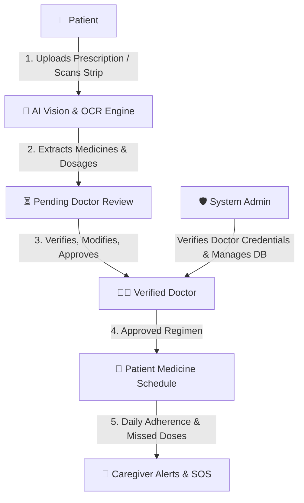

# MediMitra (मेदिमित्र) 🩺💊

> **Intelligent Multi-Role Healthcare & Medication Adherence Platform**  
> Empowering patients, connecting caregivers, and equipping doctors with verified AI prescription analysis and medicine intelligence.

[](https://www.python.org/)
[](https://flask.palletsprojects.com/)
[](https://developer.android.com/)
[](LICENSE)
[](#)

---

## 🌟 Overview

**MediMitra** is a role-segregated healthcare platform designed to prevent medication errors, streamline prescription workflows, and protect high-risk or elderly patients.

Unlike conventional reminder apps, MediMitra provides dedicated, secure portals for **Patients**, **Doctors**, **Caregivers**, and **Administrators**—anchored by an AI-assisted prescription verification pipeline that mandates doctor approval before new regimens are scheduled.

---

## 📱 Architecture & Dashboards



### 1. 🧑 Patient Dashboard
- **Personalized Schedule**: Dynamic daily timeline with before/after meal food guidance.
- **AI Medicine Strip Scanner**: Camera & gallery upload with OCR text recognition, matching Indian medicine databases (e.g., Telma, Metformin, Pan-D, Augmentin, Dolo 650) to display uses, side effects, and precautions.
- **Multilingual Voice AI**: Audio explanations and interactive questions in **Hindi, Tamil, Telugu, Kannada, Bengali, Marathi, Gujarati, and English**.
- **Adherence Ring & Stats**: Real-time adherence percentage with one-tap dose logging (`Take` / `Skip`).
- **Emergency SOS**: Quick-trigger emergency notification with blood group, allergies, and emergency contact details.

### 2. 👨‍⚕️ Doctor Dashboard
- **Prescription Review & Approval Queue**: Human-in-the-loop verification where doctors review uploaded Rx images against AI extractions, make corrections, and approve or reject before medicines reach the patient's schedule.
- **Patient Health Queries**: Secure medical consultation inbox to answer patient queries directly.
- **Adherence Monitoring**: Identify patients with low medication compliance and frequent missed doses.
- **Digital Prescription Creator**: Issue new digital prescriptions with custom dosage intervals.

### 3. 👥 Caregiver Dashboard
- **Family Member Oversight**: Track daily medication schedules of connected family members.
- **Missed-Dose Alerts**: Automated warnings when critical doses are skipped or missed.
- **Emergency Coordination**: Quick access to patient medical conditions and doctor contacts.

### 4. 🛡️ Administrator Dashboard
- **Doctor Credential Verification**: Review medical council registrations and approve/reject doctor accounts.
- **Medicine Database Management**: Curate active pharmaceutical ingredients, drug interaction rules, and safety alerts.
- **System Activity & Audit Logs**: Monitor OCR processing reliability and system usage statistics.

---

## 🚀 Key Features

| Feature | Description |
|---|---|
| **AI Vision Scanner** | Powered by Google Gemini Vision & OpenAI models with local Tesseract OCR fallback. |
| **Indian Tablet Catalog** | Curated catalog with dosages, precautions, meal timing, and side effects. |
| **Multilingual Voice Assistance** | Speech synthesis & recognition across major Indian regional languages. |
| **Doctor Safety Gate** | Zero automated prescription approval; mandates clinical human verification. |
| **Obsidian Dark Theme** | Ultra-modern, low-strain healthcare UI built with GSAP 3D card tilt and Web Audio chimes. |
| **Android APK** | Native Android Studio wrapper with camera hardware access and offline asset caching. |

---

## 🛠️ Tech Stack

- **Backend**: Python 3.11+ / 3.14, Flask, SQLite3, Jinja2, Werkzeug
- **AI & OCR**: Google Gemini Vision API, OpenAI Vision API, Tesseract OCR, PyPDF2
- **Frontend**: HTML5, CSS3 Glassmorphism, JavaScript (ES6+), GSAP 3, Lucide Icons, Web Speech API, Web Audio API
- **Mobile**: Android Studio, Java, Android WebView, Gradle
- **Authentication**: Role-Based Access Control (RBAC) with PBKDF2 password hashing & session management

---

## 💻 Getting Started

### Prerequisites
- Python 3.11+ or 3.14
- Git
- Tesseract OCR *(optional, for local text recognition)*
- Android Studio / SDK *(optional, for compiling APK)*

### Local Installation

1. **Clone the repository:**
   ```bash
   git clone https://github.com/<your-username>/MediMitra.git
   cd MediMitra
   ```

2. **Create and activate a virtual environment:**
   ```bash
   # Windows PowerShell
   py -3.14 -m venv .venv
   .\.venv\Scripts\Activate.ps1

   # Linux / macOS
   python3 -m venv .venv
   source .venv/bin/activate
   ```

3. **Install dependencies:**
   ```bash
   pip install --upgrade pip
   pip install -r requirements.txt
   ```

4. **Configure environment variables:**
   ```bash
   # Copy sample environment file
   cp .env.example .env
   ```
   Edit `.env` to configure your preferences:
   ```ini
   SECRET_KEY=your-secure-random-key
   AI_PROVIDER=gemini # or openai
   GEMINI_API_KEY=your-gemini-api-key
   GEMINI_MODEL=gemini-2.5-flash
   TESSERACT_CMD=C:\Program Files\Tesseract-OCR\tesseract.exe
   ```

5. **Initialize Database & Create Admin:**
   ```bash
   flask --app app create-admin
   ```

6. **Start the Development Server:**
   ```bash
   python app.py
   ```
   Open `http://localhost:5000` in your browser.

---

## 📱 Building the Android APK

1. Open the [`android/`](file:///D:/Celestia/MediMitra/android) directory in **Android Studio**.
2. Update the server IP address in `android/app/src/main/java/com/medimitra/app/MainActivity.java` if testing over LAN.
3. Build the APK using Gradle:
   ```bash
   cd android
   .\gradlew.bat assembleDebug
   ```
4. The generated APK will be at:
   `android/app/build/outputs/apk/debug/app-debug.apk`

---

## 🧪 Demo Credentials

For quick evaluation, seed test accounts with:
| Role | Username | Password |
|---|---|---|
| **Patient** | `patient_demo` | `password123` |
| **Doctor** | `doctor_demo` | `password123` |
| **Caregiver** | `caregiver_demo` | `password123` |
| **Admin** | `admin` | `admin123` |

---

## 📂 Directory Structure

```text
MediMitra/
├── android/                  # Native Android WebView wrapper project
│   ├── app/src/main/         # Android Manifest, Java sources & layout
│   └── build.gradle          # Gradle build scripts
├── database/                 # SQLite schema, migrations & seed scripts
│   ├── schema.sql
│   └── seed_data.py
├── routes/                   # Modular Flask Blueprints (RBAC)
│   ├── auth.py               # Authentication & role routing
│   ├── dashboard.py          # Patient wellness portal
│   ├── doctor.py             # Doctor review & patient management
│   ├── caregiver.py          # Family monitoring & alerts
│   ├── admin.py              # Platform management & verification
│   ├── scanner.py            # AI strip scanner & prescription OCR
│   ├── assistant.py          # Multilingual AI health queries
│   ├── medicines.py          # Medicine cabinet & stock tracking
│   ├── queries.py            # Patient-to-doctor messaging
│   ├── records.py            # Medical history & reports
│   └── safety.py             # Interaction checks & safety rules
├── services/                 # Business logic & AI integrations
│   ├── ai_service.py         # Gemini & OpenAI vision extraction
│   ├── ocr_service.py        # Tesseract OCR engine
│   └── safety_service.py     # Drug interaction validator
├── static/                   # Static assets
│   ├── css/                  # Obsidian dark glass styles & responsive rules
│   ├── js/                   # GSAP 3 animations, voice TTS/STT, camera logic
│   └── sounds/               # Medical UI audio feedback
├── templates/                # Jinja2 dashboard templates
├── uploads/                  # User scans & prescriptions (git-ignored)
├── app.py                    # Application factory & entry point
├── config.py                 # Configuration loader
├── MediMitra-debug.apk       # Standalone compiled Android APK
└── requirements.txt          # Python dependencies
```

---

## ⚖️ Safety & Regulatory Disclaimer

> **Important**: MediMitra is an assistive health-tech utility. AI-extracted medicine names, schedules, and instructions **never** automatically become confirmed prescriptions. All uploaded medical orders require direct human review by a verified licensed medical practitioner. MediMitra does not diagnose illnesses or modify prescribed therapies without clinical direction.

---

## 📄 License

Distributed under the MIT License. See `LICENSE` for more information.
